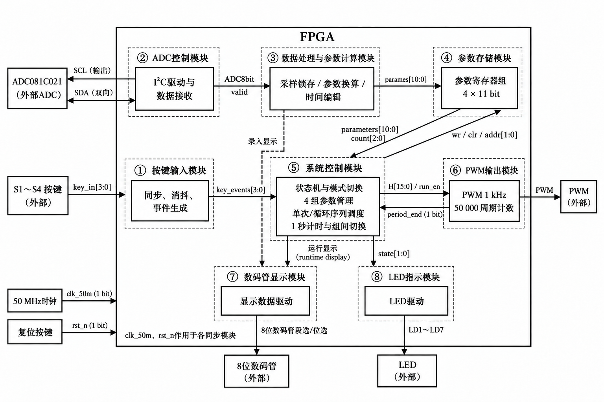

# Diagram Structure Reference

Use this guide when designing image-generated system/module block diagrams for reports. It also applies to vector or code-drawn diagrams when the same structure is appropriate. Read the general figure rules in [the report specification](report-spec.md#figures-captions-and-diagrams) as well.

## Persistent visual reference

Inspect the [user-supplied reference image](../assets/diagram-structure-reference.png) before preparing the generation prompt. Resolve this path relative to this skill, not the experiment project or a temporary clipboard folder. Supply the saved image as a visual reference to the generation tool where supported; do not rely only on a verbal recollection of it.

The reference is a structural and visual example, not experimental evidence or a universal architecture. Do not insert it unchanged as the current experiment's design. Do not automatically copy its FPGA title, eight-module count, ADC model, PWM frequency, clock frequency, widths, state names, or hardware interfaces. Every experiment-specific label and relationship must come from the actual task or implementation.

## Reusable structure

- **System boundary:** Enclose the implemented system in one prominent solid rectangular boundary with its actual system name centered near the top. Keep external devices and endpoints outside that boundary.
- **Module groups:** Use lighter dashed rectangular enclosures for functional modules. Put a short module name above the inner block, optionally preceded by a circled module number. Numbers identify modules; do not imply an execution order that the design does not have. Choose the number of modules from the actual design.
- **Functional blocks:** Within each group, use a solid rectangle with a concise description of that module's main responsibilities. Use a few readable lines rather than source code or a paragraph of explanation. Preserve clear separation between system, grouping, and functional boundaries.
- **Main arrangement:** Prefer a readable left-to-right acquisition/processing/storage or input/control/output path where the design supports it. Place central control and feedback paths so their relationships are easy to follow. Place display or indicator modules below the relevant control/processing blocks when applicable. Do not impose these roles on experiments that lack them.
- **External interfaces:** Place input devices on the left, output devices on the right or below, and shared inputs near the system boundary when appropriate. Use short endpoint labels and distinguish external hardware or external software interfaces from internal modules.
- **Connections:** Draw explicit arrowheads for actual data, control, and feedback directions. Label connections beside their paths with the actual signal/interface name and width or bus range when known. Use separate arrows for distinct request/response or feedback signals; use a bidirectional link only for a truly bidirectional interface.
- **Shared signals:** If the design has a shared clock, reset, or equivalent global input, show it once with an accurate note about the modules it serves instead of drawing a dense fan-out. Do not assume the reference's clock/reset applies to every experiment or every module.
- **Routing:** Keep labels off borders and arrowheads, route around unrelated boxes, and reduce crossings. Distinguish a junction from a crossing where needed. Dashed connections require an explicitly explained meaning supported by the design; dashed module boundaries already indicate grouping.

Use this as a hierarchy and placement reference, not a fixed grid. Do not add empty modules, unused signals, or fabricated bit widths to make the diagram resemble the sample.

For a true procedural flowchart, keep appropriate start/end, action, decision, branch, and loop semantics. Reuse the reference's restrained typography, spacing, clear grouping, and readable arrows without replacing decision nodes with misleading hardware-module boxes or inventing a system boundary solely for decoration.

## Visual treatment and generation

Use a white background, black text, black solid outlines and arrows, and lighter dashed group outlines. Match the reference's clean academic appearance. Avoid colored panels, gradients, shadows, icons, textures, and presentation-style decoration. Chinese module labels and Latin technical identifiers must remain sharp and readable at the report's insertion size.

Before generation, the parent lists the actual modules, responsibilities, external endpoints, signal directions, known widths, and any shared inputs in the existing generation workspace. Check this list against the materials before composing the prompt. A conceptual diagram may omit unknown widths; do not invent implementation detail.

The parent uses the currently available image-generation workflow and provides the saved reference image where supported, along with the actual content and layout constraints. A suitable prompt structure is:

> Use the supplied image as the structural and visual reference for an academic engineering block diagram: white background; a solid outer system boundary; dashed module groups containing solid functional blocks; concise readable labels; external endpoints outside the system boundary; and clearly directed, labeled arrows. The actual system, modules, responsibilities, interfaces, and connections are: [verified experiment-specific content]. Arrange these according to their real dependencies, preserving readable hierarchy and spacing. Do not copy the example's FPGA-specific content, add unsupported modules, or invent signals or bit widths.

Replace the bracketed content before generation. Use the general figure-output location already established for the report; the reference asset remains in the skill's `assets/` folder. Do not put the clipboard path into the report, prompt instructions that must persist, or repository documentation.

## Verification before insertion and during review

Inspect the generated image itself, not just the prompt. Check every group name, functional description, endpoint, signal label, arrow direction, width, and shared-signal note against the verified design. Check that external devices remain outside the system boundary, functional blocks remain within their groups, and connectors do not imply unsupported dependencies.

Check Chinese glyphs, technical identifiers, line styles, enclosure hierarchy, label placement, crossings, and clipping at the intended document size. Similar-looking generated text is not proof of a correct port name. The parent corrects or regenerates errors before insertion; reviewers return findings only.

Prefer a clear overview plus a separate detail diagram if the content cannot remain readable in one figure. Preserve the report's existing image-sizing and pagination rules; do not squeeze dense text into a tiny figure or leave excessive page gaps merely to match the sample's aspect ratio.
